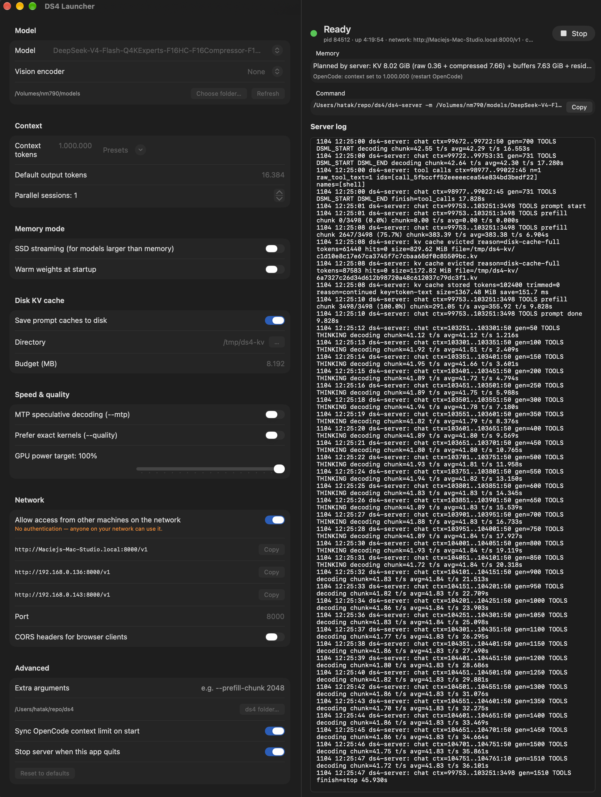

# DS4 Launcher

A small native macOS app for starting and stopping
[ds4-server](https://github.com/antirez/ds4) (DwarfStar) with the options you
want, without typing long command lines.



## Features

- **Model picker.** Scans your models folder for `.gguf` files and shows their
  sizes. Optionally picks a vision encoder for image input.
- **Context and output.** Context size with presets from 8K to 1M, default output
  tokens, and parallel sessions.
- **Memory mode.** SSD streaming on/off with its expert cache and layer options,
  plus warm weights at startup.
- **Memory bar.** Estimates usage against the GPU memory limit and warns when a
  model won't fit. Once the server is running, it shows the server's own figure.
- **Other options.** Disk KV cache, MTP speculative decoding, `--quality`, GPU
  power target, extra arguments.
- **Network switch.** Off: only this Mac can connect. On: other machines on your
  network can connect, and the app lists the addresses to use.
- **Command preview.** Shows the exact `ds4-server` command, with a Copy button.
- **Start/Stop.** A status light (Loading, Ready, Exited), uptime and a live
  server log, capped in memory and rotated on disk.
- **Stray servers.** Finds `ds4-server` processes started outside the app and
  can stop them.
- **OpenCode sync.** Optionally sets the context limit of the `ds4` provider in
  `~/.config/opencode/opencode.json` to match the server.

## Requirements

- macOS 14 or later on Apple Silicon
- Xcode Command Line Tools (`xcode-select --install`). Full Xcode isn't needed.
- A built [ds4](https://github.com/antirez/ds4) checkout (`make`) and at least
  one downloaded model

## Build

```sh
./build.sh            # builds build/DS4 Launcher.app
./build.sh --install  # also copies it to ~/Applications
```

## Usage

Open `DS4 Launcher.app`. On first launch, set:

- **ds4 folder** (Advanced): your ds4 checkout. The default is `~/repo/ds4`.
- **Models folder** (Model → Choose folder…): where your `.gguf` files are. The
  default is `~/repo/ds4/gguf`. If you download with
  `DS4_GGUF_DIR=/path ./download_model.sh …`, choose that path.

Pick a model, adjust options and press **Start server** (⌘↩).

| File | Path |
|---|---|
| Settings | `~/Library/Application Support/DS4Launcher/settings.json` |
| Server log | `~/Library/Logs/DS4Launcher/ds4-server.log` (rotated at 20 MB) |

## Notes

- **No authentication.** With network access on, anyone on your network can use
  the server. Only turn it on for trusted networks.
- **Quitting.** Quitting the app stops the server unless you turn off "Stop
  server when this app quits". If you leave it running, the next launch lists it
  under other ds4-server processes, where you can stop it.
- **Memory estimate.** For DeepSeek it includes the context. For other models it
  shows the weights only, until the server reports its real figure on start.
- **OpenCode sync.** It rewrites `opencode.json` with keys sorted. The first
  time, it saves a backup to `opencode.json.bak`.

## License

MIT. See [LICENSE](LICENSE). This project isn't affiliated with ds4.
